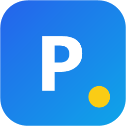
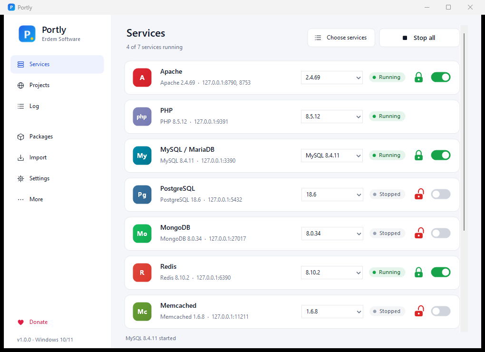
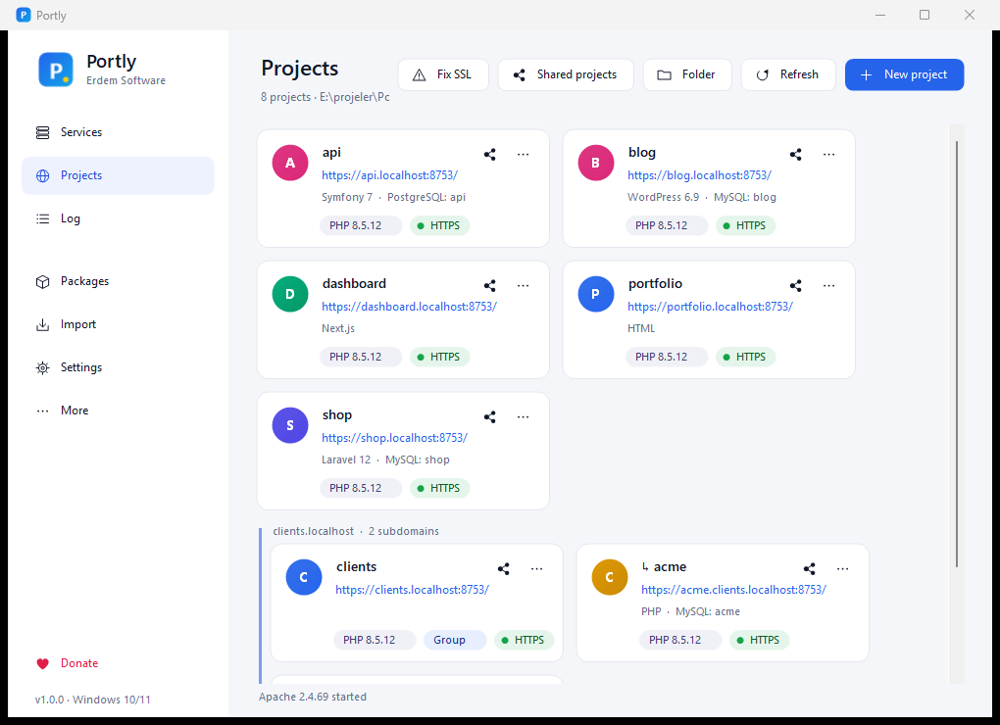
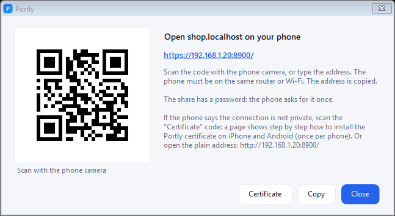
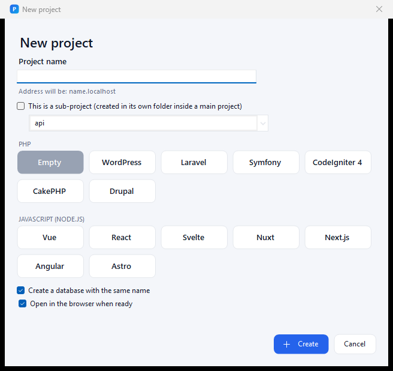

<p align="center"></p>

<h1 align="center">Portly</h1>
<p align="center">
  Windows용 빠르고, 휴대 가능한, 오픈소스 로컬 웹 개발 환경<br>
  <sub>제작: <a href="https://erdemsoftware.com">Erdem Software</a> · MIT · 광고 없음, 추적 없음</sub>
</p>

<p align="center"><a href="README.md">English</a> · <a href="README.tr.md">Türkçe</a> · <a href="README.zh-CN.md">简体中文</a> · <a href="README.es.md">Español</a> · <a href="README.pt-BR.md">Português (BR)</a> · <a href="README.de.md">Deutsch</a> · <a href="README.fr.md">Français</a> · <a href="README.ru.md">Русский</a> · <a href="README.ja.md">日本語</a> · <b>한국어</b> · <a href="README.ar.md">العربية</a> · <a href="README.id.md">Bahasa Indonesia</a></p>
<p align="center"><sub>앱 자체는 31개 언어를 지원합니다 (아랍어, 페르시아어, 우르두어는 오른쪽에서 왼쪽으로 쓰입니다).</sub></p>

---

<p align="center"> </p>
<p align="center"> </p>

Portly는 하나의 폴더에서 Apache 또는 Nginx, PHP, MySQL 또는 MariaDB, PostgreSQL, MongoDB, Redis, Memcached, Node.js, Mailpit, Composer, Adminer, phpMyAdmin을 실행합니다. 설치 프로그램이 필요 없고, 기본적으로 Windows에 아무것도 설치하지 않습니다. Windows 서비스도, 레지스트리 잔여물도 없습니다 (선택 사항인 서비스 모드는 Settings > Features에서 켜야 활성화되며, 스택을 서비스로 실행할 수 있습니다). USB 메모리에서도 동작합니다.

## 왜 Portly인가?

| | Laragon | **Portly** |
|---|---|---|
| 라이선스 | 비공개 소스, 상업적 사용 시 유료 | **MIT, 완전 무료, 광고 없음** |
| 앱 업데이트 | 새 설치 프로그램 다운로드 | **앱 안에서 클릭 한 번** (SHA-256 검증) |
| 패키지 목록 | 로컬 `packages.conf` | **원격으로 업데이트되는 카탈로그** + windows.php.net의 실시간 PHP 버전 |
| 사이트별 PHP 버전 | 아니요 | **예** (모든 PHP 버전이 각자의 FastCGI 포트에서 실행) |
| HTTPS | 인증서 하나, 프로젝트마다 다시 생성 | **로컬 루트 CA**를 한 번만 신뢰하고, 사이트마다 인증서 발급 |
| 네트워크 보안 | 모든 인터페이스에서 수신 | **기본적으로 127.0.0.1** (방화벽 알림 없음) |
| PHP 보안 강화 | 기본값 | `session.upload_progress` 및 `allow_url_include` **꺼짐** |
| 비정상 종료 안전성 | — | Portly가 종료되면 Windows가 Portly가 시작한 서버를 중지 (작업 개체) |
| 포트 충돌 | 오류 메시지 | 포트를 사용 중인 프로그램을 표시; **클릭 한 번으로 사용 가능한 포트로 전환**하거나 해당 프로그램 종료 |
| 공유 | ngrok (계정 필요) | **로컬 네트워크** (같은 Wi-Fi의 휴대폰/태블릿, QR 코드, https, 비밀번호) 및 Cloudflare를 통한 **인터넷**: 계정 없이 무작위 주소, 또는 **내 도메인의 고정 주소** |
| 마이그레이션 | — | **Laragon, XAMPP, WampServer, AMPPS, UwAmp, Uniform Server, Open Server, EasyPHP, MAMP**의 프로젝트와 데이터베이스 (Herd와 Local의 프로젝트) |
| 데이터베이스 | MySQL | **MySQL 또는 MariaDB, PostgreSQL, MongoDB, SQLite**; Redis 및 Memcached |
| 데이터베이스 도구 | HeidiSQL | **phpMyAdmin** (root 비밀번호가 없는 동안 로그인된 상태로 열림), **Adminer, HeidiSQL, DBeaver, Beekeeper Studio, DbGate, DB Browser for SQLite** |
| WordPress | 수동 | **클릭 한 번으로 WordPress** (WP-CLI, 관리자 사용자 준비됨) |
| 언어 | 34 (txt) | **31개**, 일반 JSON, 기여 환영 |
| Windows 7 / 8 / 8.1 | 불명확 | **별도의 Legacy 에디션** |

## 기능

- **프로젝트**: `www`의 모든 폴더는 `https://name.portly`이 됩니다. Laravel 방식의 `public` 폴더는 자동 인식됩니다. 폴더 그룹과 하위 프로젝트(`blog.shop.portly`), Laravel, Symfony, CodeIgniter, CakePHP, Drupal, Vue, React, Svelte, Nuxt, Next.js, Angular, Astro용 템플릿을 지원합니다. 각 카드는 프로젝트의 사용 기술과 데이터베이스를 보여줍니다.
- **프로젝트 공유**
  - *로컬 네트워크*: QR 코드로 휴대폰에서 엽니다. https로 동작하며, 휴대폰의 안내에 따라 iPhone과 Android에 Portly 인증서를 한 번 설치합니다. 선택 사항으로 비밀번호, 시간 제한, Portly와 함께 시작, 연결된 기기 목록을 설정할 수 있습니다. 휴대폰에서 발생한 PHP 오류는 Portly 로그에 표시됩니다.
  - *인터넷*: 무료 Cloudflare 빠른 터널(계정 불필요), 또는 Cloudflare 계정을 통한 `demo.example.com` 같은 내 도메인. 비밀번호, 시간 제한, 기기 목록은 동일합니다.
- **사이트별 PHP 버전**, 클릭 한 번으로 **PHP 확장** 설치 (PHP 버전별로 검증된 PECL 확장 17개), **Xdebug**, 프로젝트의 PHP / Node 버전을 따르는 터미널 (`.php-version`, `composer.json`, `.nvmrc`).
- **서비스**: 서비스별 자물쇠가 있는 모두 시작 / 모두 중지 (그룹에 속할 서비스를 선택), 하나의 카드에 있는 MySQL / MariaDB, 선택 사항인 Tomcat + Java.
- **업데이트 알림** ("PHP 8.6 출시" → 클릭 한 번으로 설치 및 전환), 지원 종료 및 CVE 경고.
- **데이터베이스 안전성**: 검사 및 복구, MySQL / MariaDB 버전 간 안전한 이동, 대용량 SQL 가져오기, 자동 백업, 잊어버린 root 비밀번호 재설정, InnoDB 복구 모드.
- **개발자 워크플로**: 백그라운드 작업(큐, 스케줄러, Vite), 사이트 로그, 프로파일러, 훅을 지원하는 `portly` CLI, `portly.yml` 프로젝트 파일, SSH를 통한 push / pull.
- **사이트**: 추가 도메인과 와일드카드 도메인, 직접 만든 인증서, 아카이브, SSL 수정, Firefox / Java 인증서 신뢰, **Caddy** 및 **FrankenPHP** (Octane).
- **문제 예방**: OneDrive 폴더, ASCII가 아닌 문자 및 긴 경로, 두 번째 PHP 또는 PHPRC, hosts 파일을 막는 백신, 격리 검사.
- Windows 설정을 따르는 밝은 / 어두운 테마의 현대적인 사이드바 UI, 모니터별 DPI 및 화면 낭독기 지원. 자주 사용하지 않는 기능은 Settings > Features에서 켭니다.

## 에디션

| 다운로드 | Windows | 업데이트 | 패키지 |
|---|---|---|---|
| `Portly-x.y.z-win10-11.zip` | 10 / 11 (64비트) | **예**: 앱 + 패키지 카탈로그 | 최신: PHP 8.5, MySQL 8.4 LTS / 26.x, Apache 2.4, Node 24 LTS ... |
| `Portly-x.y.z-win7-8.zip` (Legacy) | 7 SP1 / 8 / 8.1 (64비트) | **아니요** (고정된 카탈로그) | Windows 7에서 실행되는 마지막 버전: PHP 8.2, MySQL 5.7, Apache 2.4 VS16, Node 13 |
| macOS / Linux | — | — | **베타**: 아래 [Portly 2 베타](#portly-2-beta) 섹션을 참고하세요. |

Legacy 에디션은 .NET Framework 4.8이 필요합니다 (Windows 10 / 11에는 이미 포함되어 있습니다).

<a id="portly-2-beta"></a>

## Portly 2 베타: macOS, Linux 및 새로운 Windows 앱

Portly 2는 **macOS(Apple Silicon 및 Intel), Linux(x64 및 arm64), Windows 10 / 11**에서 실행되며, 모든 플랫폼에서 같은 버전 번호를 사용합니다. 현재 베타 버전이며, Portly 1.x가 계속 안정 버전으로 유지되고 자동으로 2로 업데이트되지 않습니다.

- **macOS / Linux**: 한 줄 명령, sudo 불필요 (SHA-256 검사; macOS: `/Applications/Portly.app`, Linux: `~/.local/share/portly`):

  ```sh
  curl -fsSL https://raw.githubusercontent.com/erdemsoftware/portly/main/tools/install.sh | sh
  ```

  또는 [Releases](https://github.com/erdemsoftware/portly/releases)에서 `.dmg`, `.AppImage`, `.deb` 또는 `.tar.gz`를 내려받으세요.
- **Windows 10 / 11**: 같은 페이지의 `Portly-2.x.y-beta.n-windows-x64.zip`을 새 폴더에 압축 해제합니다.
- macOS / Linux: Xdebug 포함 PHP, Caddy, Apache, Nginx, MySQL, MariaDB, PostgreSQL, MongoDB, Redis, Memcached, Mailpit, Node.js가 `~/Portly`에 설치되며, 프로젝트는 `https://name.localhost`에서 열립니다.

## 빠른 시작

1. [Releases](https://github.com/erdemsoftware/portly/releases)에서 zip 파일을 내려받아 **공백이 없는** 폴더에 압축을 풉니다. 예: `C:\Portly`.
2. `Portly.exe`를 실행합니다. 처음 시작할 때 권장 패키지가 미리 선택되어 있습니다. **Install selected**를 클릭하세요.
3. **Start all**을 클릭합니다.
4. `www` 안에 폴더를 만듭니다: `www\shop`은 `https://shop.portly`가 됩니다. 도메인처럼 이름 붙인 폴더(`www\example.com`)는 `https://example.com`으로 열리므로, 실제 서비스로 올릴 때도 주소가 그대로 유지됩니다. 카드의 Local / Live 전환으로 PC에서 실제 사이트를 다시 불러올 수 있고, 로컬 사본은 `https://example.com.portly`에서 계속 동작합니다.

`http://localhost`는 모든 사이트, Adminer, Mailpit, `phpinfo()`가 있는 대시보드를 엽니다. 자세한 내용은 [docs/04-kullanim.md](docs/04-kullanim.md) 문서를 참고하세요 (터키어).

```
Portly\
├─ Portly.exe            the app
├─ lang\  templates\     languages and config templates (renewed by updates)
├─ bin\                  packages: bin\php\php-8.5.12-..., bin\mysql\mysql-8.4.11-winx64 ...
├─ etc\                  generated configuration (rewritten at every start)
├─ usr\                  your settings, own templates, SSL authority (never touched by updates)
├─ data\                 databases (one folder per MySQL series)
├─ www\                  your projects (another folder can be chosen in Settings)
└─ logs\  tmp\  backup\
```

설정 템플릿을 바꾸려면 `templates\`에서 `usr\templates\`로 복사한 뒤 사본을 편집하세요. 업데이트는 이 파일을 건드리지 않습니다.

## 소스에서 빌드

요구 사항: .NET SDK 6 이상 아무 버전 (앱은 .NET Framework 4.8을 대상으로 하므로 추가 런타임 없이 Windows 7 SP1 – 11에서 실행됩니다). Inno Setup이 설치되어 있으면 `build.ps1`은 설치 프로그램도 만듭니다.

```powershell
powershell -ExecutionPolicy Bypass -File build.ps1            # both editions -> dist\
dotnet build src\Portly\Portly.csproj -c Release              # Windows 10/11 edition only
dotnet build src\Portly\Portly.csproj -c Release -p:Edition=Legacy
dotnet run --project tests\Portly.SmokeTest -c Release        # end-to-end test on test ports
```

아키텍처: [docs/02-mimari.md](docs/02-mimari.md), 배포: [docs/03-yayinlama.md](docs/03-yayinlama.md) (터키어).

## 번역

언어 파일은 [`src/Portly/lang`](src/Portly/lang)에 있습니다. `en.json`을 복사하고 값을 번역한 뒤 `{0}` 자리 표시자를 그대로 유지하고 풀 리퀘스트를 보내세요. 누락된 키는 영어로 대체됩니다. [CONTRIBUTING.md](CONTRIBUTING.md)를 참고하세요.

## 개인정보 보호

Portly에는 원격 측정, 분석, 계정이 없습니다. 사용자가 직접 시작하거나 켠 기능에 대해서만 다른 시스템에 연결합니다:

- **업데이트 확인** (기본적으로 켜져 있으며 설정에서 끌 수 있음): 이 GitHub 저장소에서 패키지 카탈로그와 릴리스 정보를 내려받습니다. 사용자나 프로젝트에 관한 정보는 전송되지 않습니다.
- **패키지 설치**: 공식 출처(windows.php.net, dev.mysql.com, nodejs.org ...)에서 내려받습니다.
- **프로젝트를 인터넷에 공유**: Cloudflare의 `cloudflared`를 실행합니다. 방문자는 Cloudflare를 거쳐 사이트에 접속합니다. 로컬 네트워크 공유는 내부 네트워크 안에 머무릅니다.

Portly는 시스템 설정을 알림을 통해서만 변경합니다. hosts 파일과 로컬 인증 기관 신뢰 설정은 확인을 요청합니다 (Windows UAC).

**제거**: 휴대용 zip 버전은 폴더를 삭제하면 제거됩니다. 설치 버전은 Windows 설정 > 앱에서 제거합니다. 신뢰된 Portly 인증 기관도 제거하려면 `certmgr.msc` > 신뢰할 수 있는 루트 인증 기관 > 인증서를 열고 "Portly Local CA"를 삭제하세요.

## 코드 서명 정책

Windows 릴리스는 GitHub Actions가 이 저장소에서 빌드합니다. SignPath Foundation을 통한 코드 서명을 신청한 상태입니다. 그때까지 릴리스는 서명되지 않으며, 각 릴리스와 함께 SHA-256 체크섬이 게시됩니다.

팀 역할:
- 작성자 / 커미터: [Erdem Software](https://github.com/erdemsoftware)
- 리뷰어: [Erdem Software](https://github.com/erdemsoftware)
- 승인자 (릴리스 서명): [Erdem Software](https://github.com/erdemsoftware)

## 후원

Portly는 무료이며 계속 무료로 제공됩니다: 광고 없음, 유료 등급 없음, 추적 없음. 시간을 절약해 주었다면 개발을 후원할 수 있습니다.

- 카드: **[Buy Me a Coffee](https://buymeacoffee.com/erdemsoftware)**
- Binance Pay ID: **50018297**
- 암호화폐 (TRC-20, BEP-20, Polygon, Solana, Ethereum의 USDT): 앱에서 메뉴 > Donate

---

<sub>Apache, PHP, MySQL, MariaDB, PostgreSQL, MongoDB, Nginx, Node.js, Redis, Memcached, Mailpit, Composer, Adminer, phpMyAdmin, Cloudflare 및 기타 도구는 공식 출처에서 내려받으며 각 소유자의 자산입니다. Portly는 Laragon과 제휴 관계가 없습니다.</sub>
